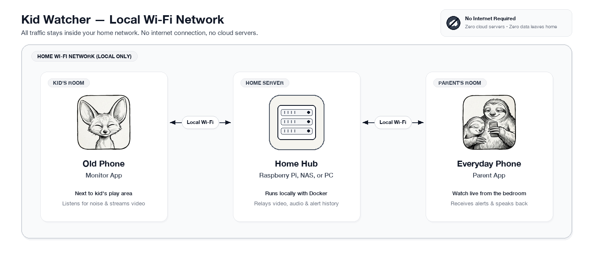
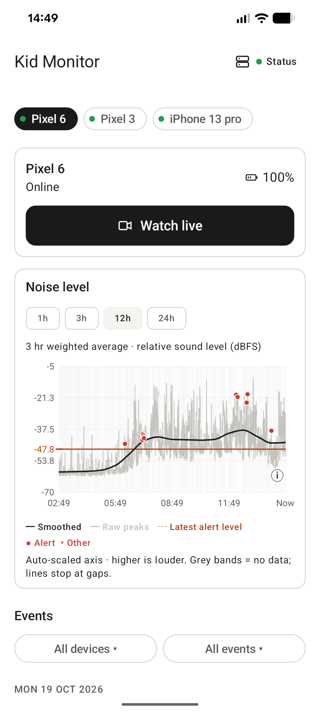
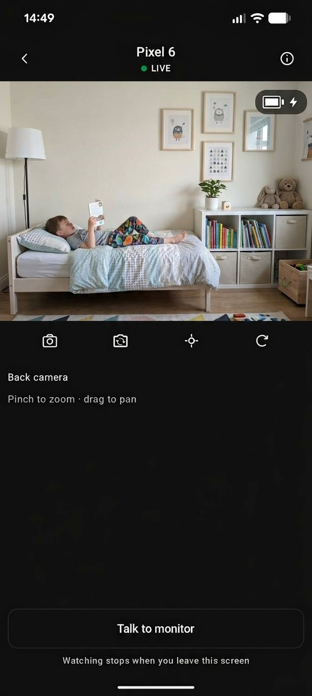
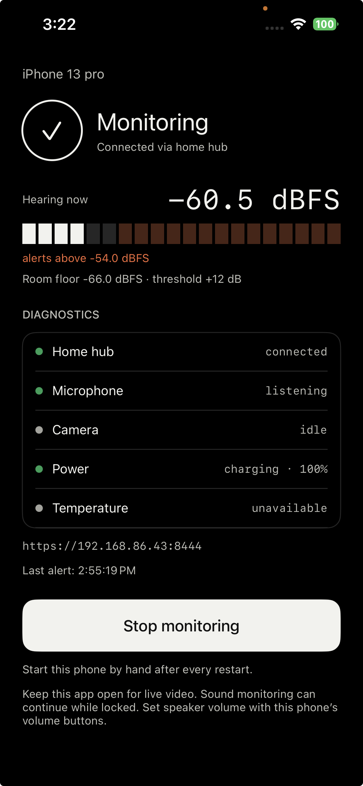

# Kid Watcher

Turn the old phones in your drawer into a kid monitor or a room camera.

An old **Android phone or iPhone** becomes the monitoring device: it listens in
the room, raises an alert when it gets loud, and streams live video and audio to
your everyday phone on demand. You can talk back through it, so you can answer a
child from another room.

**Everything stays on your home network.** There is no account to create, no
cloud service, and no telemetry. Audio, video and alerts travel from the phone
to a small server you run yourself and back to your own phone — nothing is sent
to the authors of this project or to anyone else.

## What it does

- **Noise monitoring.** The monitor measures the room continuously and raises
  an alert when sound stays above its threshold. It adapts to the room's own
  background level, and keeps 24 hours of history you can scroll through.
- **Live video and audio, on demand.** Pull up the feed when you want it. The
  camera runs only while you are watching. The microphone is always listening,
  because that is how noise is detected, but audio is only streamed to you
  while the live view is open.
- **Talk back.** Send your voice to the monitoring phone's speaker.

## Screenshots

| Parent Dashboard | Live Video Feed | Monitor App |
| :---: | :---: | :---: |
|  |  |  |

## What it doesn't do

- **No night vision.** There is no night vision because phones do not support night
  vision. Standard smartphone cameras lack infrared sensors and IR illuminators,
  so the room needs some ambient lighting (such as a nightlight or dim lamp) to
  be visible in the dark.
- **No access outside your local network.** This app does not work if your devices
  leave your local network. Everything stays strictly local and is only available
  via devices connected to the same Wi-Fi local network. There is no cloud relay,
  no external server, and no remote access over the internet.

## Prerequisites

### 1. Hardware & network

- **An always-on Linux box on your home Wi-Fi** to run the hub: a Raspberry Pi 4
  or newer, a container-capable NAS, a mini-PC, or an old laptop. It needs
  Docker with the Compose plugin, and nothing else. This is the central relay
  and trust anchor that coordinates the phones and holds the event history.
- **A phone to leave in the room** (camera and microphone):
  - **Android**: Android 12 (API 31) or newer.
  - **iOS**: iPhone running iOS 16 or newer.
- **Your everyday phone** for the parent app:
  - **Android**: Android 10 (API 29) or newer.
  - **iOS**: iPhone or iPad running iOS/iPadOS 16 or newer (foreground LAN monitoring).
- **Home Wi-Fi network**: All devices must connect to the same local Wi-Fi router.

### 2. Device setup & accounts

- **For Android (Monitor or Parent)**:
  - **No developer account needed.** Sideloading development APKs is free and requires
    no Google Play registration, account setup, or fees.
  - **Enable Developer options**: Open *Settings > About phone* and tap *Build number*
    7 times until developer options are unlocked.
  - **Enable debugging**: In *Settings > System > Developer options*, turn on
    **USB debugging** (or **Wireless debugging** on Android 11+).
  - Apps are built and installed directly onto the device using standard `adb`
    (Android Debug Bridge).

- **For iOS (Monitor or Parent)**:
  - **Mac with Xcode required**: iOS apps must be compiled on macOS using Xcode.
  - **Apple Developer account required for signing**:
    - An Apple ID is required to sign the app in Xcode (*Settings > Accounts*, then select
      your team under *Signing & Capabilities*).
    - **Free Apple ID (Personal Team)**: Builds and installs to a physical device at no
      financial cost, but Apple expires free provisioning profiles after 7 days
      (requiring the app to be re-signed and reinstalled).
    - **Paid Apple Developer Program account** ($99/year): Provides 1-year certificates
      suitable for uninterrupted, unattended monitor use.
  - **Enable Developer Mode**: On the iPhone or iPad, go to *Settings > Privacy & Security >
    Developer Mode*, turn it on, and restart the device when prompted. Then trust the
    developer certificate under *Settings > General > VPN & Device Management*.
  - **First-time connection**: Connect the iPhone to the Mac via USB cable once and tap
    *Trust This Computer*; subsequent builds and test runs can work over Wi-Fi.

## Getting started

**The easiest route is to let a coding agent do it.** Clone the repository, open
a coding agent in the project directory, and ask it to set the system up
end to end — the hub on your server, the monitor app on the phone you are
retiring, and the parent app on your everyday phone. `AGENTS.md` tells the agent
how this project expects to be worked on, and the guides below are written to be
followed by a person or an agent equally well.

Prefer to do it by hand, or want to know what the agent will do?

| Guide | What it covers |
| --- | --- |
| [`docs/guides/setup-hub.md`](docs/guides/setup-hub.md) | Standing the hub up, its TLS certificate, and issuing pairing codes |
| [`docs/guides/installing-monitor.md`](docs/guides/installing-monitor.md) | Naming, installing and pairing a monitoring phone |
| [`docs/guides/deploying.md`](docs/guides/deploying.md) | Running the hub as a real deployment |
| [`docs/guides/reading-noise-chart.md`](docs/guides/reading-noise-chart.md) | Reading the noise history, and what the numbers mean |
| [`docs/guides/recovering-hub.md`](docs/guides/recovering-hub.md) | Getting back up after a power cut or reboot |

[`ARCHITECTURE.md`](ARCHITECTURE.md) describes how the pieces fit together, and
[`docs/README.md`](docs/README.md) maps the rest of the documentation.

## How the privacy claim is kept

- The hub listens on your LAN only. Both phones dial out to it; neither accepts
  inbound connections.
- Every device authenticates with a token it receives once, during pairing. The
  hub generates its own TLS certificate on first start, and the apps pin its
  fingerprint, so a device will not talk to a hub it has not been paired with.
- The apps use no analytics, crash reporting or push service. Notifications are
  raised locally by the parent app, not delivered through a vendor's servers.
- Nothing is published outside your network unless you deliberately expose the
  hub's port to the internet, which this project does not ask you to do.

## Status

Phase 1: LAN-only. Both the monitor and parent apps are implemented for Android
and iOS:
- **Android monitor and parent**: Verified on real hardware, including phones as
  old as a Pixel 3 on Android 12.
- **iOS monitor**: Builds, installs, pairs, and streams live video and audio to
  parents.
- **iOS parent**: Built as a separate SwiftUI app (`KidsParent`), verified on iPhone
  and iPad with foreground LAN delivery, noise history charts, live view, and
  talkback.

[`docs/planning/roadmap.md`](docs/planning/roadmap.md) tracks what is done and
what is next.

## Licence

MIT. See [`LICENSE`](LICENSE).
