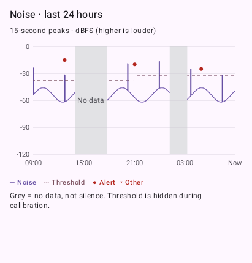
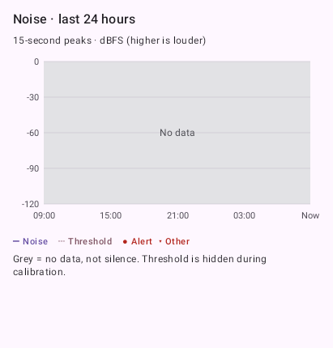

# 24-hour noise history above Alerts

Date: 2026-10-03
Status: implemented, tested, and deployed to the home hub and paired phones.

## Behavior

The main Alerts screen shows a rolling 24-hour chart above the existing event
list. Time is on the X axis, digital noise level in dBFS on the Y axis. Higher
values are louder; this is the microphone's digital level, not calibrated
sound-pressure level. The purple trace shows the peak RMS level in each
15-second summary, preserving brief loud sounds that an average could hide.
The recorded effective threshold is dashed, so changes to configuration or the
adaptive floor appear at their historical values. Calibration retains levels
but has no active threshold line.

Noise alerts are dots at their actual event time and measured peak. Events with
no loudness measurement, such as monitor loss, appear as triangles in a separate
lane above the plot. They never become artificial noise measurements. Tap the
plot to inspect time, level/threshold or “No data”, and a nearby alert. With
multiple monitors, chips select which monitor's chart is shown; the event list
continues to show its existing combined history and acknowledgement behavior.

Grey areas are explicitly labeled “No data”, with a persistent legend saying
that missing data is not silence. Coverage is inferred only from received
measurement intervals, never from heartbeats, online flags, or absence of
alerts. Measured digital silence (-120 dBFS) remains a valid trace. Existing
historical alerts can appear over a grey background when continuous noise
levels were not yet collected.

## Data path and battery implications

- The monitor's existing audio-read loop feeds `NoiseHistoryAccumulator` with
  each window's level and duration. It computes mean energy in the linear
  domain, peak RMS, and threshold, and emits a compact `noise_level` summary
  about every 15 seconds. A pause longer than 250 ms, clock rollback, or
  calibration transition closes the preceding interval instead of filling the
  gap. Up to 250 ms of scheduling jitter is treated as continuous capture.
- No recording, audio upload, new microphone, camera, wake lock, background
  timer, or extra audio analysis loop is introduced. Continuous capture was
  already active. Costs added are numeric aggregation, roughly 240 small
  metadata messages/hour/monitor and SQLite writes. This is not a measured
  battery-drain claim.
- Hub migration 2 adds `noise_samples`. The watchdog prunes levels older than
  two days. The authenticated noise-history endpoint defaults to the last day,
  accepts `fromMs` for incremental samples, and includes the complete day's
  events independently of that cursor. More than 5000 markers sets an explicit
  truncation warning. Noise interval length and finite digital levels are
  validated, and extreme clock skew is rejected.
- Parent migration 1→2 adds measurement and chart-marker caches without
  changing the alert table or acknowledgement state. Marker fetches must not
  advance the normal event backfill cursor; the two caches are deliberately
  separate. Cached measurements remain visible when the hub cannot be reached.
- The parent makes an initial 24-hour fetch, then fetches only new intervals
  with one interval of overlap. It polls about once a minute only while Alerts
  is visible and refreshes immediately on resume/reconnect/Refresh. The plot's
  time window advances every 15 seconds even during disconnection. Returning
  from live view reloads history. Failed requests preserve saved measurements,
  show an update error, and leave unmeasured intervals grey.
- Capture stop can leave the final unfinished interval unreported. Lost
  telemetry during a socket outage is not replayed; those periods stay grey.
  The most recent reported data can lag the monitor by about 75 seconds due
  to the summary/poll intervals. The chart is historical feedback, while
  immediate alert delivery continues over the existing socket.

The Compose chart uses the platform's existing
[Canvas and text drawing APIs](https://developer.android.com/develop/ui/compose/graphics/draw/overview).
No chart-library dependency was added.

## Verification

- 174 TypeScript tests passed; type checking passed.
- 354 Android tests passed: shared 121 (4 environment-dependent live tests
  skipped), monitor 105, parent 128. Both debug APKs built successfully.
- All 29 cross-language message encodings, binary frames and constants passed
  protocol conformance, including summaries with a null calibration threshold.
- Hub tests cover wire ingestion and history retrieval, incremental samples
  with complete-day markers, empty history, authentication/query validation,
  retention/retransmission, and preservation of existing hub data during migration.
- Kotlin tests cover RMS energy versus arithmetic decibel averaging, retained
  brief peaks, capture pauses/clock rollback, calibration, true silence versus
  missing data, 24-hour clipping, duplicate coverage, threshold history, parent
  migration with acknowledged alerts, and the independent chart-marker cursor.
- Native Robolectric renders of the real Compose chart were visually inspected
  for both populated history with gaps and completely missing history. These
  use synthetic fixtures, not readings from the user's room.
- `git diff --check` and the secret scan passed.

On October 3, hub revision `14ef48c` was deployed to `hub-host`, followed by
in-place debug app updates on the Pixel 8 Pro (parent) and Pixel 6 (monitor).
The hub database was backed up and the previous image tagged before deployment.
Migration 2 preserved all 274 existing events. Both phones retained pairing;
the parent reconnected after the hub restart and the monitor resumed 16 kHz
capture after Start monitoring was tapped. Real 15-second summaries reached
the hub with measured levels, peaks, and adaptive thresholds.

The real chart was visually checked on the Pixel 8 Pro after the charging,
locked-phone soak and again after live-view recovery. Recent noise levels,
the threshold, alert markers over grey pre-collection history, the explicit
No data legend, and the preserved event list were visible. The hub received
49 continuous summaries during the 12-minute soak (largest internal gap 4 ms).
See [the hardware recovery results](progress-cold-start-retries.md).

No pre-existing continuous measurements can be recovered from stored alerts,
so grey pre-update history is expected. Longer hardware checks remain needed
for controlled quiet/loud sequences, calibration, and multiple monitors.
Deployment while charging does not establish unplugged battery drain or
resolution of the original intermittent 20-minute interruption.

## Component previews (synthetic data)

